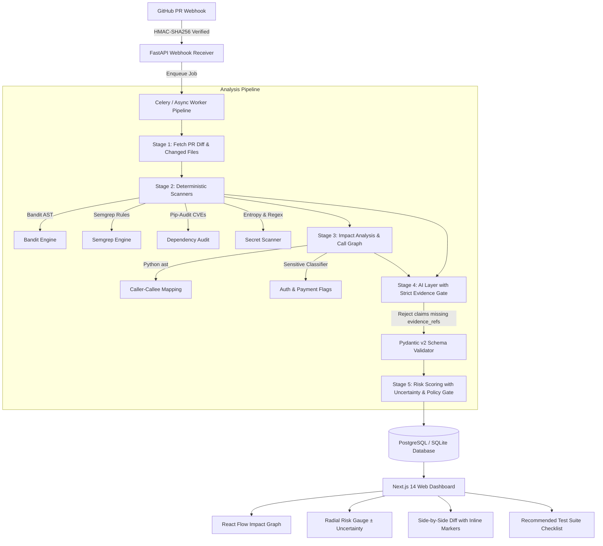

# PR Risk Intelligence

> **AI-Powered SaaS that analyzes GitHub Pull Requests for security risks, change impact, and recommended tests before merge.**
> *Core Principle: Evidence over AI vibes.*

---

## 🌟 Overview

Pull requests are the highest-leverage security boundary in modern software development. Traditional CI tools either overwhelm developers with false-positive scanner alerts or emit generic AI advice that lacks verified code references.

**PR Risk Intelligence** bridges this gap:
1. **Verified Evidence vs. AI Hypotheses**: Deterministic scanner proofs (Semgrep, Bandit, pip-audit, secret detection) are clearly separated in the UI from contextual AI hypotheses.
2. **Blast Radius Impact Analysis**: AST call-graph tracing maps callers of changed functions and flags modifications to sensitive surfaces (authentication, payments, crypto, database).
3. **Actionable Pre-Merge Tests**: Generates exact, copyable pytest commands to verify safety prior to approval.
4. **Prioritization Aid, Never Proof of Safety**: Every risk score displays a visible uncertainty range ($\pm \text{margin}$) to keep engineering teams honest.
5. **Defense Against Untrusted Diffs**: Strips and isolates prompt-injection attacks hidden inside diffs or code comments.

---

## 🏗 Architecture & Data Flow



---

## 🚀 Quickstart & Local Execution

### Option 1: Standalone Local Dev (Instant Zero-Setup Demo)

No Docker or external services required. SQLite and seeded demo datasets run out of the box.

#### 1. Backend (FastAPI)
```bash
# In project root
python -m pip install -r apps/api/requirements.txt

# Run backend API server (runs on http://localhost:8000)
python apps/api/app/main.py
```
- API Docs & Swagger UI: `http://localhost:8000/docs`
- Health check: `http://localhost:8000/health`

#### 2. Frontend (Next.js)
```bash
cd apps/web
npm install
npm run dev
```
- Web Application: `http://localhost:3000`
- Hero PR Detail Screen: `http://localhost:3000/dashboard/scans/demo-scan-142`
- Merge Policies & Live Simulation: `http://localhost:3000/dashboard/policies`
- Scan History & Calibration: `http://localhost:3000/dashboard/history`

---

### Option 2: Docker Compose (Full Production Stack)

Launches PostgreSQL, Redis, Celery Worker, FastAPI API, and Next.js Frontend together:

```bash
cd docker
docker-compose up --build
```

---

## 🧪 Running Unit Tests

The test suite validates finding normalization, fingerprint deduplication, HMAC webhook signatures, AST call-graph building, scoring uncertainty calculations, and AI evidence-reference rejection:

```bash
python -m pytest
```

All 12 unit tests execute in under 1 second with 100% pass rate.

---

## 🛡 Security & Defense Principles

- **Untrusted Code Isolation**: PR diffs are treated as hostile user input. Code strings are bounded by delimiter markers and screened for prompt injection payloads.
- **HMAC-SHA256 Webhooks**: Validates `X-Hub-Signature-256` using timing-safe comparison (`hmac.compare_digest`).
- **No Hallucinated Claims**: AI hypotheses without verifiable `evidence_refs` (pointing to lines or scanner rules) are automatically rejected by schema validation.
- **Safe Secrets Masking**: Leaked tokens (Stripe keys, AWS access keys) are redacted in log outputs.

---

## 📂 Monorepo Structure

```plaintext
├── apps/
│   ├── api/                   # Python FastAPI backend, scanners, AST analyzer, AI layer
│   │   ├── app/
│   │   │   ├── api/v1/        # Webhook, PRs, scans, impact graph, policies, demo endpoints
│   │   │   ├── core/          # Config, database, security HMAC, prompt injection guard
│   │   │   ├── models/        # SQLAlchemy ORM models
│   │   │   ├── schemas/       # Pydantic v2 contract schemas
│   │   │   ├── services/      # Scanners (Bandit, Semgrep, pip-audit, secrets, normalizer)
│   │   │   │                  # Analyzer (AST parser, call graph, sensitive classifier)
│   │   │   │                  # AI client & strict evidence validator
│   │   │   └── worker/        # Celery background tasks
│   │   └── tests/             # Pytest unit tests (12 tests)
│   └── web/                   # Next.js 14 App Router, React, Tailwind, Framer Motion, React Flow
│       └── src/
│           ├── app/           # Landing, Dashboard, Hero PR Scan, Policies, History, Settings
│           ├── components/    # Risk gauge, Impact graph, Diff viewer, Finding card, Tests checklist
│           └── lib/           # Typed API client with seeded offline fallback
├── docker/                    # Docker Compose & environment templates
├── .github/workflows/         # CI testing and security self-scan
└── README.md
```

---

## 📄 License
MIT License. Built with Next.js, FastAPI, Semgrep, Bandit, and React Flow.
